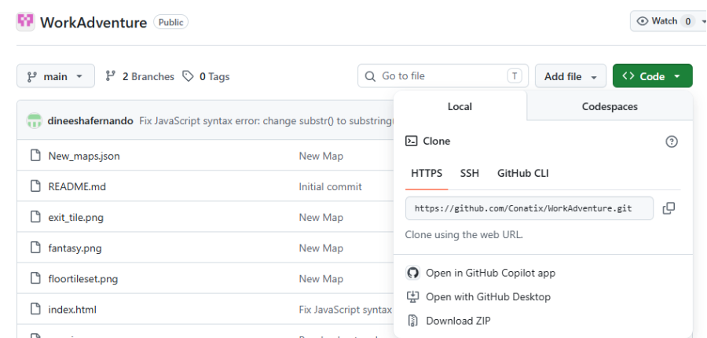
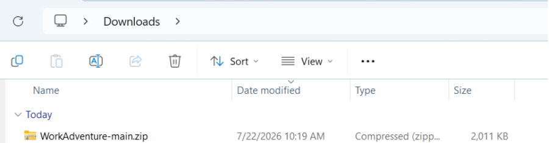
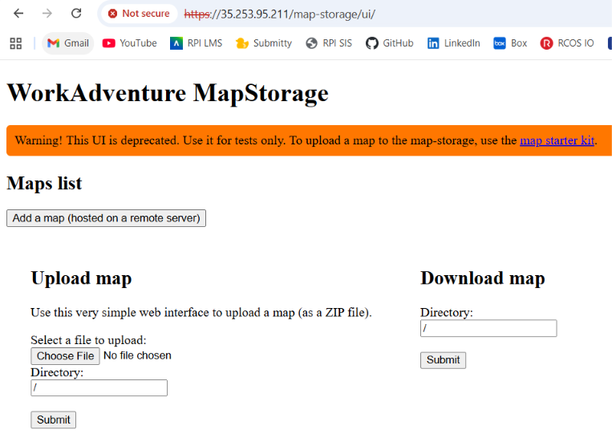
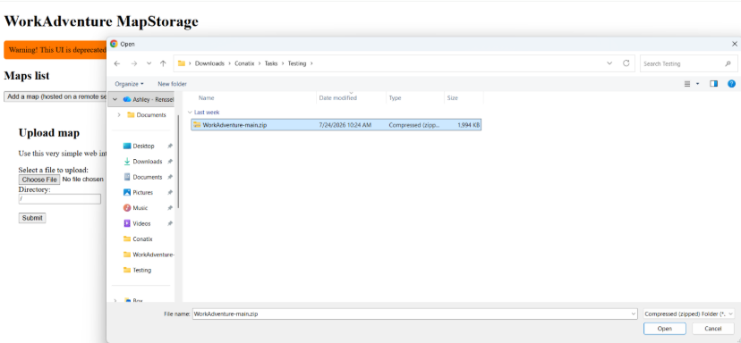
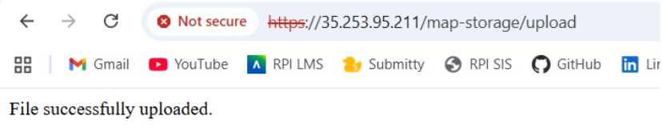
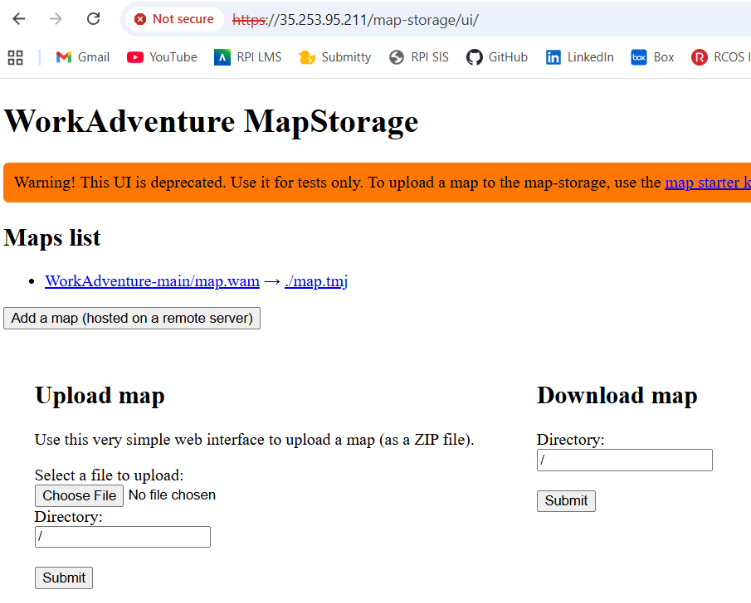

# How to Upload Maps to WorkAdventure

## Step 1: Download the Company's Map from GitHub

1. Go to the company's WorkAdventure GitHub repository:

   `https://github.com/Conatix/WorkAdventure`

2. Click the green **Code** button.

3. Click **Download ZIP**.

4. The downloaded ZIP file should now appear in **File Explorer**.

> **Note:** Make sure you know where the ZIP file was downloaded. You will need to select this file when uploading it to Map Storage.

---

## Step 2: Access WorkAdventure Map Storage

To access WorkAdventure's Map Storage, open a web browser and go to the production server's domain or IP address followed by `/map-storage`.

### If using a domain name

For example:

`https://workadventure.conatix-office.conatix.com/map-storage`

### If using an IP address

For example:

`https://DOMAIN-IP/map-storage`

1. You will be prompted to sign in with a username and password. 
2. To get the username and password, look for **MAP_STORAGE_AUTHENTICATION_USER** and **MAP_STORAGE_AUTHENTICATION_PASSWORD** in the .env file in the WorkAdventure folder of the VM's repository. 
3. Use Ctrl + F to easily search for these variables. 

---

## Step 3: Upload the Map

After signing in, you will be taken to the **WorkAdventure Map Storage** UI.

1. Click **Choose File**.

2. Select the ZIP file that you downloaded from GitHub.

4. Click **Submit**.

5. The page should display a message confirming:

   **File Successfully Uploaded**

---

## Step 4: Confirm the Map Was Uploaded

To confirm that the map was successfully uploaded, return to:

`https://DOMAIN-IP/map-storage`

The uploaded map should now appear in the **Maps list**.

The blue link on the left shows the file path where the map is stored.

For example:

`WorkAdventure-main/map.wam`

In this example:

* `WorkAdventure-main` is the uploaded map folder.
* `map.wam` is the WorkAdventure map file.

You will need this file path to access the map in WorkAdventure.

---

## Step 5: Access the Uploaded Map in WorkAdventure

Once the map has been successfully uploaded, you can access it through the WorkAdventure server using the following URL format:

`http://DOMAIN_ADDRESS/~/MAP_FILE_PATH`

### Example

If the server's IP address is:

`35.253.95.211`

And the map file path is:

`WorkAdventure-main/map.wam`

The URL would be:

`http://35.253.95.211/~/WorkAdventure-main/map.wam`

Open this URL in a web browser to access the WorkAdventure server using the uploaded map.

---

## Summary

The overall process is:

1. Download the map repository from GitHub as a ZIP file.
2. Open the WorkAdventure Map Storage page.
3. Sign in to Map Storage.
4. Upload the ZIP file.
5. Confirm that the map appears in the **Maps list**.
6. Copy the map's file path.
7. Add the file path after `/~/` in the WorkAdventure URL.
8. Open the resulting URL to access the map.
